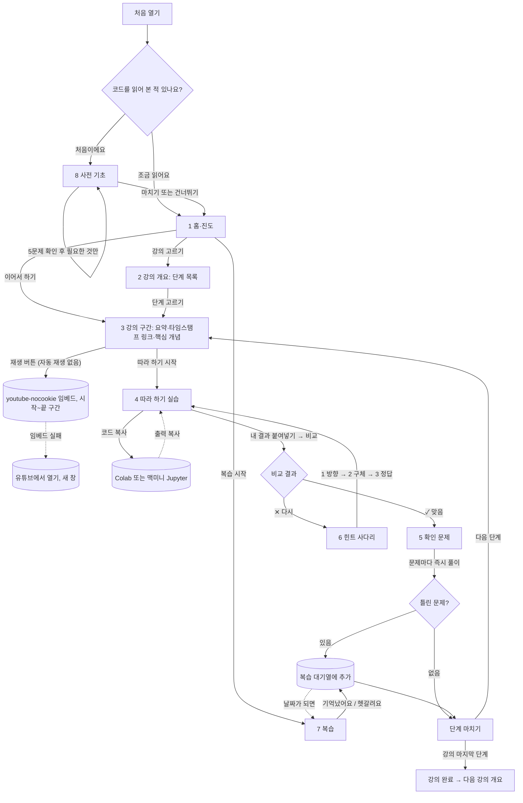

# Z2H 학습 흐름 v1

작성: 디자이너 몽키 · 2026-11-16 KST · 상태: 초안 (pedagogy/, research/ 산출물 도착 전)

## 1. 기본 단위

- **강의** 10편 (01 micrograd ~ 10 Reproduce GPT-2 124M)
- 강의마다 **단계**(챕터) N개. 화면에는 "단계 4 / 12"처럼 위치를 늘 보여 준다. N은 리서치·교사 몽키가 정한다.
- 단계 하나 = **영상 구간 보기 → 따라 하기 → 확인 문제** 3칸. 영상이 없는 단계(예: 08 강연 뒤 정리)는 영상 칸을 건너뛴다.
- 틀린 문제와 핵심 개념은 **복습 대기열**에 들어간다 (1일 → 3일 → 7일 → 14일).
- 강의 전 **사전 기초**(파이썬 읽기·수학 감 잡기)는 권장이지만 막지 않는다.

## 2. 흐름도

## 3. 화면 목록

| 번호 | 화면 | 주 기기 | 목업 |
|---|---|---|---|
| 1 | 홈·진도 | 모바일·데스크톱 | `mockups/png/s1_home_{m390,d1280}.png` |
| 2 | 강의 개요 (단계 목록) | 모바일·데스크톱 | `s2_lecture_*` |
| 3 | 강의 구간 (임베드 플레이어·요약·핵심 개념) | 모바일 읽기 | `s3_segment_*` |
| 4 | 따라 하기 실습 (대표 화면) | 데스크톱 넓은 화면 | `s4_practice_*` |
| 5 | 확인 문제 | 모바일 | `s5_quiz_*` |
| 6 | 힌트 사다리 (상태 4개) | 실습 화면 안 | `s6_hints_*` |
| 7 | 복습 | 모바일 | `s7_review_*` |
| 8 | 사전 기초 진입 | 모바일·데스크톱 | `s8_basics_*` |
| 9 | 빈·불러오는 중·오류 | 공통 | `s9_states_*` |

## 4. 화면 전환 규칙

| 출발 | 동작 | 도착 | 비고 |
|---|---|---|---|
| 1 홈 | 이어서 하기 | 마지막으로 멈춘 칸 (3, 4, 5 중) | 단계 안 위치까지 기억 |
| 1 홈 | 강의 행 | 2 강의 개요 | |
| 1 홈 | 복습 시작 | 7 복습 | 오늘 0개면 버튼 대신 빈 상태 문구 |
| 2 개요 | 단계 행 | 3 구간 | 잠금 없음. 앞 단계를 안 해도 열 수 있음 (경고 문구만) |
| 3 구간 | 플레이어 재생 | 같은 화면 안 임베드 재생 | 시작 시각부터, 끝 시각에 멈춤. 자동 재생 없음 |
| 3 구간·4 실습 | 유튜브에서 열기 | YouTube 새 창 | 임베드 실패 때와 모바일 앱으로 보고 싶을 때 |
| 3 구간 | 따라 하기 시작 | 4 실습 | 영상을 안 봐도 진행 가능 |
| 4 실습 | 비교 ✓ | 확인 문제 버튼 강조 | 자동 이동하지 않음 |
| 4 실습 | 비교 ✕ | 같은 화면 + 힌트 패널 강조 | 자동으로 힌트를 열지 않음 |
| 4 실습 | 힌트 열기 | 6 힌트 (데스크톱: 오른쪽 패널, 모바일: 같은 화면 아래 펼침) | |
| 5 문제 | 단계 마치기 | 다음 단계의 3 구간 | 틀린 문제는 복습에 이미 들어간 상태 |
| 7 복습 | 문제 항목 | 그 문제 화면 (복습 모드) | 풀면 대기열로 돌아옴 |
| 어디서나 | 하단 탭 / 상단 메뉴 | 홈, 강의, 복습, 기초 | 4개 고정 |

## 5. 모바일과 데스크톱 역할

- 모바일 (767px 이하): 읽기, 영상 구간 (플레이어 맨 위, 접기 가능), 확인 문제, 복습. 실습 화면도 동작하지만 줄 다음 풀이가 쌓이는 1단.
- 데스크톱 (1024px 이상): 실습 2단 (코드 | 한국어 풀이) + 오른쪽 패널 (영상 플레이어, 힌트, 진행).
- 태블릿 (768~1023px): 모바일 1단 배치에 여백만 넓힘.
