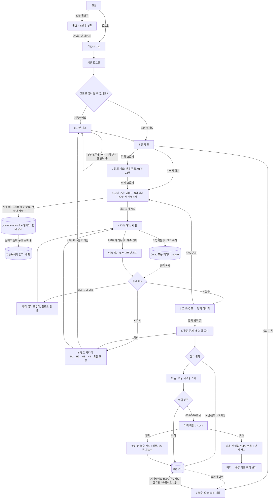
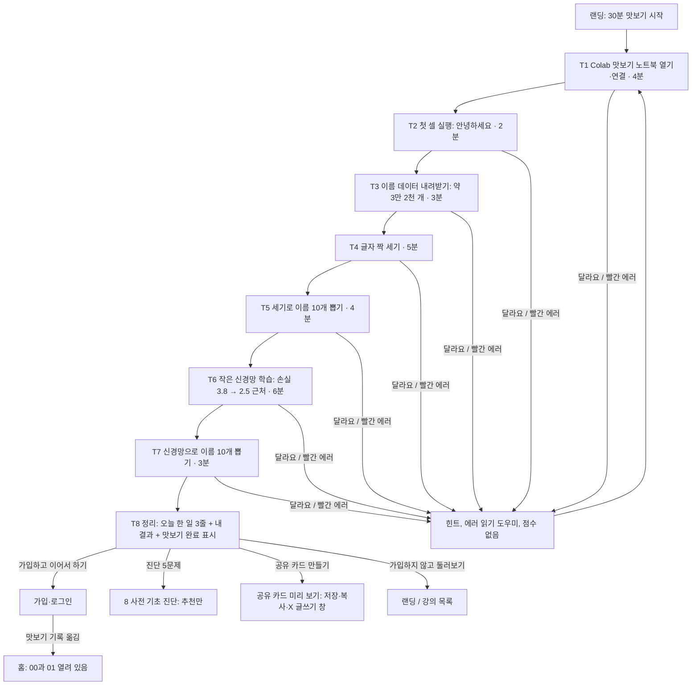
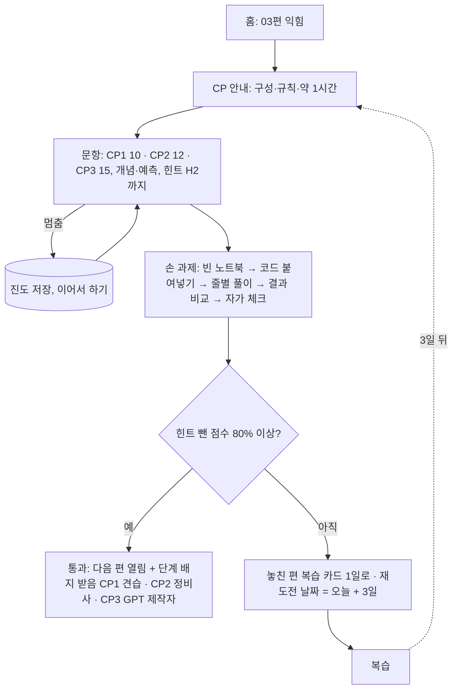
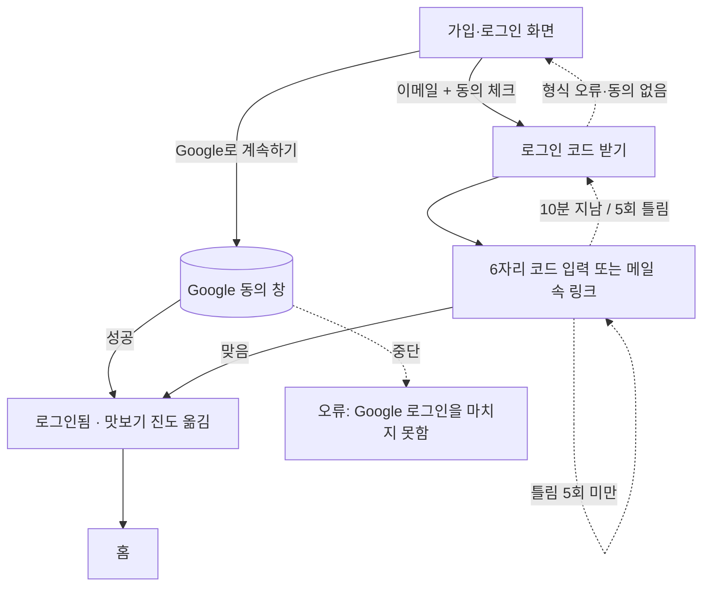
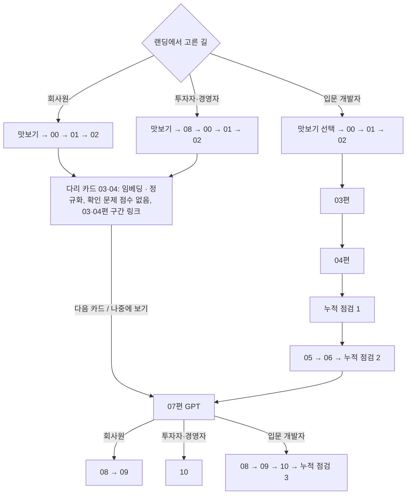

# Z2H 학습 흐름 v2 (20:18 pedagogy v1.1 반영)

작성: 디자이너 몽키 · 2026-11-16 KST · v1.2: 영상 임베드(19:43), CEO 답(19:52), 교사 몽키 pedagogy v1(19:53) 반영 · v1.3: 교사 C1~C10 답(20:07) · v2: 일반 사용자 제품, 랜딩·맛보기·가입·배지(얼큰이 지시 t833u 20:06, CEO 전달)

## 1. 기본 단위 (pedagogy/data-spec 기준)

- **강의** 10편 `L01`~`L10`. 단계 수 (pedagogy v1.1) 01:22, 02:16, 03:12, 04:18, 05:13, 06:12, 07:23, 08:8, 09:13, 10:28 (합 165, 긴 단계 76). 쪼갠 단계는 `L01-S14b`.
- **단계** `L01-S04` 형식. 단계마다 새 코드 1~5줄 (나누면 뜻이 깨지는 "긴 단계"는 10줄까지, `long_step: true`), 새 개념 1개, 세 칸 **입력할 것 → 보여야 하는 것 → 그 뜻**. 화면에는 늘 "단계 4 / 16".
- 준비된 코드(`prepared_code`)는 붙여넣기만, 예측·채점 없음 (D41). 영상 없는 단계(L08-S01·S04·S08)는 플레이어 없이 바로 할 일 (D40). 구간이 여럿이면 "구간 1/3" 전환 (D38).
- 단계 하나 = 영상 구간 보기 → 따라 하기 (예측 → 실행 → 결과 비교). 확인 문제(`L01-Q03`)는 몇 단계 범위마다 묶어서 나온다.
- 편 끝: **핵심 재구성 과제** (`L01-R1`~), **익힘 판정** (`mastery_state`), 그 뒤 복습 카드 생성.
- 03·06·10편 뒤 **누적 점검** CP1~CP3 (통과하면 다음 편이 열림, CP3 = 수료).
- 08편은 강연 편: 보기 → 정리 카드 채우기 → 내 말로 설명. L08-S04는 선택 실습 (건너뛰기 가능).
- **사전 기초** F-P1~F-P9, F-M1~F-M6. 진단 5문제는 추천만 한다.
- **복습** 1 → 3 → 7 → 14 → 30일 → 졸업 뒤 60일마다. 결과는 통과 / 흔들림 / 놓침.
- 진도는 시제품에서 **맥미니에 계정별 데이터 구조**로 저장해 기기 사이에 이어진다 (D43, 20:34). 공개 서버 DB와 위치는 공개 출시 때 CTO 제안 + 얼큰이 승인. 가입 전 맛보기 진도는 브라우저에 두었다가 가입 때 옮긴다.

## 2. 흐름도

누적 점검 화면은 v1.3에서 그렸다 (7절, D36). 재구성 과제·익힘 판정 화면은 아직 없다.

## 3. 화면 목록

| 번호 | 화면 | 주 기기 | 목업 |
|---|---|---|---|
| 1 | 홈·진도 (실습 시간 수정 포함) | 모바일·데스크톱 | `mockups/png/s1_home_{m390,d1280}.png` |
| 2 | 강의 개요 (단계 목록) | 모바일·데스크톱 | `s2_lecture_*` |
| 3 | 강의 구간 (임베드 플레이어·요약·새 개념) | 모바일 읽기 | `s3_segment_*` |
| 4 | 따라 하기 실습 (세 칸, 대표 화면) | 데스크톱 넓은 화면 | `s4_practice_*` |
| 5 | 확인 문제 (예측·설명 + 채점 기준 체크) | 모바일 | `s5_quiz_*` |
| 6 | 힌트 사다리 (4단계 + 도움 요청) | 실습·문제 화면 안 | `s6_hints_*` |
| 7 | 복습 (세 결과, 25분 상한) | 모바일 | `s7_review_*` |
| 8 | 사전 기초 진입 (진단 추천) | 모바일·데스크톱 | `s8_basics_*` |
| 9 | 빈·불러오는 중·오류·동기화·영상 상태 | 공통 | `s9_states_*` |
| 10 | 강연 편 단계 (L08 정리 카드, 선택 실습 건너뛰기) | 모바일·데스크톱 | `s10_l08_*` |
| 11 | 누적 점검 안내 (v1.3) | 모바일·데스크톱 | `c1_cp_intro_*` |
| 12 | 누적 점검 문항 (힌트 H2까지) | 모바일·데스크톱 | `c2_cp_item_*` |
| 13 | 누적 점검 손 과제 (코드·줄별 풀이·비교·자가 체크) | 데스크톱 | `c3_cp_hands_*` |
| 14 | 누적 점검 결과 (통과 / 아직) | 모바일·데스크톱 | `c4_cp_result_*` |
| 15 | 준비된 코드 · 붙여넣기만 (L01-S06) | 데스크톱 | `c5_prepared_*` |
| 16 | 구간 전환 1/3 (L02-S12) · 영상 없는 단계 (L08-S01) | 모바일·데스크톱 | `c6_segments_*` |
| A | 랜딩 (v2) | 모바일·데스크톱 | `v2_landing_*` |
| B | 맛보기 단계 (Colab, 준비된 코드, 8단계 중 6) | 데스크톱 권장, 모바일 동작 | `v2_taste_step_*` |
| C | 맛보기 8/8 정리 + 선택 가입 | 모바일·데스크톱 | `v2_taste_done_*` |
| D | 가입·로그인 (코드 입력, 오류 6개) | 모바일·데스크톱 | `v2_auth_*` |
| E | 배지 4 + 편 도장 10 + 공유 카드 미리 보기 ("저장한 이미지를 첨부해 주세요") | 모바일·데스크톱 | `v2_badges_*`, 카드 `card_names` / `card_wavenet` / `card_gpt` (1200x675) |
| F | 다리 카드 03·04 (회사원·투자자 길만, D48) | 모바일·데스크톱 | `v2_bridge_*` |

## 4. 화면 전환 규칙

| 출발 | 동작 | 도착 | 비고 |
|---|---|---|---|
| 1 홈 | 이어서 하기 | 마지막으로 멈춘 곳 (3, 4, 5 중) | 단계 안 위치까지 서버에 저장 |
| 1 홈 | 실습 시간 "수정" | 같은 카드 안 편집 | 저장하면 "수정됨" |
| 1 홈 | 강의 행 | 2 강의 개요 | 잠긴 편(점검 전)은 decisions C5 |
| 1 홈 | 복습 시작 | 7 복습 | 0장이면 빈 상태 문구 |
| 2 개요 | 단계 행 | 3 구간 | 단계 잠금 없음 |
| 3 구간 | 플레이어 재생 | 같은 화면 임베드 재생 | 시작 시각부터, 끝 시각에 멈춤 |
| 3 구간·4 실습 | 유튜브에서 열기 | YouTube 새 창 | 임베드 실패, 구간 준비 중, 휴대폰 앱으로 볼 때 |
| 3 구간 | 따라 하기 시작 | 4 실습 | 영상을 안 봐도 진행 가능 |
| 4 실습 | 예측 저장 / 모르겠어요 | "보여야 하는 것" 열림 | 예측은 점수 없음, 막지 않음 |
| 4 실습 | 비교 ✓ | "그 뜻" 강조, "단계 마치기" | 자동 이동 없음 |
| 4 실습 | 비교 ✕ | 같은 화면, 힌트 카드 강조 | 힌트 자동 열기 없음. 비교 1회 = 시도 1회 |
| 4 실습 | 에러 글 붙여넣기 | 에러 읽기 도우미 | 힌트로 세지 않음 |
| 4·5 | 힌트 열기 | 6 힌트 (데스크톱 오른쪽 패널, 모바일 아래) | 한 번에 한 단계 |
| 6 힌트 | "기초 F-xx로 돌아가 보기" | 8 기초의 그 단위 | 돌아오면 같은 문제 |
| 4 실습 | 단계 마치기 (문제 범위 끝) | 5 확인 문제 | |
| 5 문제 | 제출 | 같은 카드에 풀이·점수 | 풀이는 제출 뒤에만 |
| 10 L08 | 건너뛰기 (S04) | 다음 단계 | `skipped_optional` |
| 7 복습 | 세 버튼 | 다음 카드 | 간격만 바뀜 |
| 어디서나 | 동기화 "✕ 오프라인" | 같은 화면 안내 카드 | 학습은 계속 가능 |

## 5. 모바일과 데스크톱 역할

- 모바일 (767px 이하): 읽기, 영상 구간 (플레이어 맨 위, 접기), 확인 문제, 복습. 실습도 동작 (1단, 줄 아래 풀이).
- 데스크톱 (1024px 이상): 실습 세 칸 3열 + 코드·풀이 2단 + 오른쪽 패널 (플레이어, 힌트, 진행).
- 태블릿 (768~1023px): 모바일 배치에 여백만 넓힘.

## 6. 30분 맛보기 흐름 (v2, D30, VALUE_CURRICULUM 3절)

- 모든 맛보기 셀은 준비된 코드 (D41): 붙여넣기만, 예측·채점 없음. 결과 확인은 "비슷해요 / 달라요".
- 실행은 무료 Colab (설치 없음). 처음 안의 브라우저 안 실행은 쓰지 않음 (X1 닫힘).
- 가입 권유는 T8 한 번뿐. 맛보기 기록은 가입 전 브라우저 저장 (7일, 가정 X8).
- 맛보기 T4~T7은 02편 S01~S16의 압축판이다 (VALUE 3절). 02편에서 같은 내용을 한 줄씩 다시 만든다.

## 7. 누적 점검 흐름 (v1.3, D36)

## 8. 가입·로그인 흐름 (v2, D33)

## 9. 길별 흐름과 다리 카드 (D48, 교사 20:34)

- 다리 카드는 회사원·투자자 길에서만 07편 전에 한 번. 입문 개발자 길에는 없다 (03·04편을 직접 함).
- 확인 문제는 점수 없음, 07편을 잠그지 않는다. "나중에 보기"로 건너뛸 수 있고 강의 목록에서 다시 열 수 있다.
- 단계 배지는 CP 통과로만 받는다 (D47). 짧은 길(03·04편 건너뜀)에서 누적 점검을 어떻게 볼지는 정해지지 않았다 (교사 확인, decisions X14).
